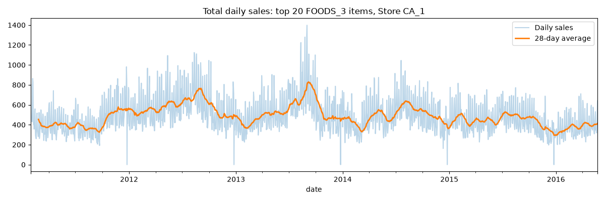
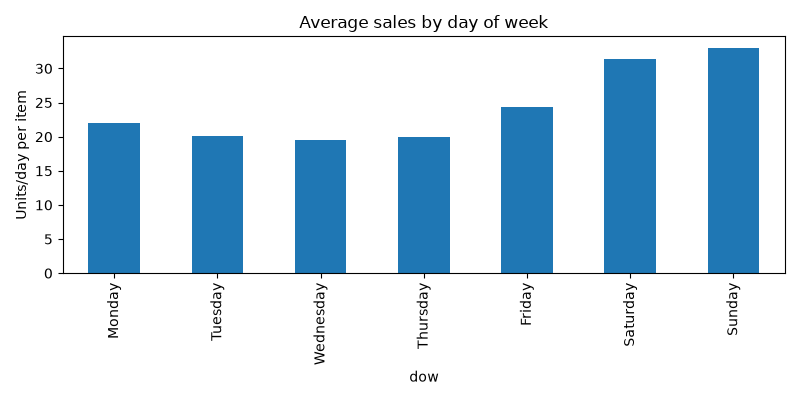
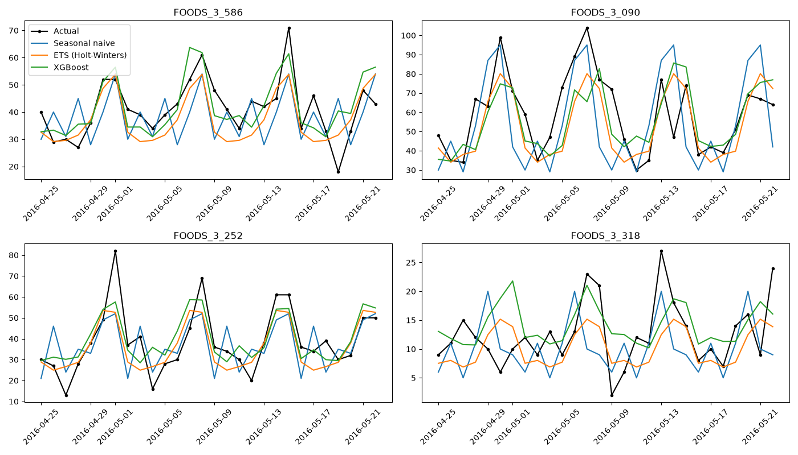
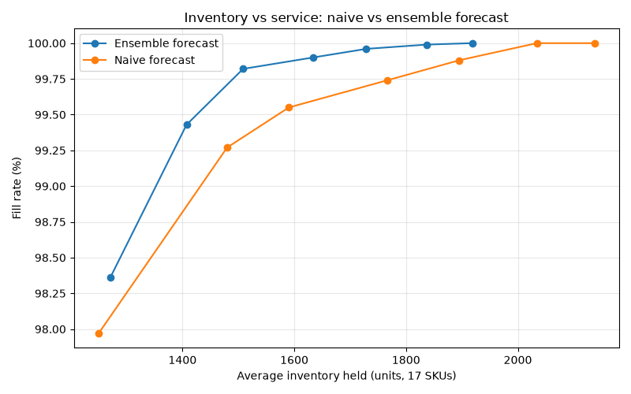

# DemandIQ: Retail Demand Forecasting & Inventory Optimization

Forecasting daily demand for 20 grocery SKUs (Walmart M5 dataset) and turning those forecasts into **(Q, R) inventory policies**, tested in a day-by-day simulation against actual demand.

## Key Results

| Metric | Seasonal Naive | ETS | XGBoost | **Ensemble** |
|---|---|---|---|---|
| WAPE | 30.9% | 24.7% | 26.5% | **23.3%** |
| RMSE | 10.59 | 8.57 | 9.13 | **8.23** |
| Bias | −9.3% | −9.8% | +4.3% | **−2.8%** |

- **24.6% lower forecast error** (WAPE) than the seasonal naive baseline
- **Forecast bias cut from −9.8% to −2.8%** by combining ETS (under-forecasts) with XGBoost (over-forecasts)
- **22.5% less safety stock** at a 95% service target (604 → 468 units)
- **8.8% less inventory at a higher fill rate** (99.96% vs 99.88%) compared with the same policy driven by a naive forecast
- **3,797 stockout-censored days** detected and imputed across 14 SKUs before modelling

## Business Problem
A store must decide how much of each product to stock. Under-stocking loses sales; over-stocking ties up cash and shelf space. Better forecasts reduce the uncertainty that safety stock has to cover, which means **less inventory for the same service level**.

## Data
[M5 Forecasting - Accuracy](https://www.kaggle.com/competitions/m5-forecasting-accuracy) (Kaggle): 5 years of daily Walmart sales.
Scope: **Store CA_1 · FOODS_3 department · top 20 SKUs by volume** (1,941 days each).

## Approach

| Step | What | Key decisions |
|---|---|---|
| 1. Load | Filter, reshape wide → long, join calendar and prices | ABC logic: focus on top-volume SKUs |
| 2. EDA | Trend, weekly seasonality, variability (CV), zero-streaks | Weekends ~70% above midweek; SNAP days +6% |
| 3. Clean | Christmas closures, pre-launch periods, stockouts | Zero runs of 7+ days treated as **censored demand** and imputed with item × weekday median |
| 4. Forecast | Seasonal naive vs ETS (Holt-Winters) vs XGBoost vs ensemble | 28-day holdout; all XGBoost lags ≥ 28 days (no leakage); scored only on real-demand days |
| 5. Inventory | EOQ, safety stock, (Q, R) policy, discrete-event simulation | σ measured on a separate validation window; service-level sweep compares forecasts fairly |

## Charts

**Demand trend and weekly pattern**



**Forecast vs actual (28-day test)**


**Inventory vs service frontier.** The ensemble reaches the same fill rate with less stock.


## Project Structure
```
├── src/
│   ├── step1_load.py        # filter, reshape, merge
│   ├── step2_eda.py         # patterns, variability, charts
│   ├── step3_clean.py       # stockout detection and imputation
│   ├── step4_forecast.py    # naive, ETS, XGBoost, ensemble
│   └── step5_inventory.py   # EOQ, safety stock, (Q,R) simulation
├── outputs/                 # charts and result tables
├── data/                    # M5 files (not tracked, see below)
└── requirements.txt
```

## How to Run
1. Download `sales_train_evaluation.csv`, `calendar.csv` and `sell_prices.csv` from Kaggle into `data/`
2. Install and run:
```bash
pip install -r requirements.txt
python src/step1_load.py
python src/step2_eda.py
python src/step3_clean.py
python src/step4_forecast.py
python src/step5_inventory.py
```

## Assumptions
| Parameter | Value |
|---|---|
| Lead time | 3 days |
| Ordering cost | $5 per order per SKU |
| Holding cost | 30% of unit cost per year |
| Unit cost | 70% of selling price |
| Stockout cost | Lost margin (lost-sales model) |
| Max order size | 14 days of demand (shelf life) |

## Limitations and Next Steps
- The test window is 28 days; a rolling multi-window backtest would make the results more robust
- Costs and lead time are assumed, not observed
- Safety stock σ comes from ETS validation error as a proxy for the ensemble
- 3 SKUs whose test period was entirely stockouts (likely discontinued) were excluded from the inventory stage
- Next: probabilistic forecasts (quantile regression), multi-store allocation, and supplier lead-time variability

## Tech Stack
Python · pandas · NumPy · statsmodels · XGBoost · Matplotlib

---
**Author:** Nalluri Sanjay, B.Tech (Hons.) Industrial & Systems Engineering, IIT Kharagpur
[LinkedIn](https://www.linkedin.com/in/sanjaynalluri2405/) · [GitHub](https://github.com/SanjayNalluri)